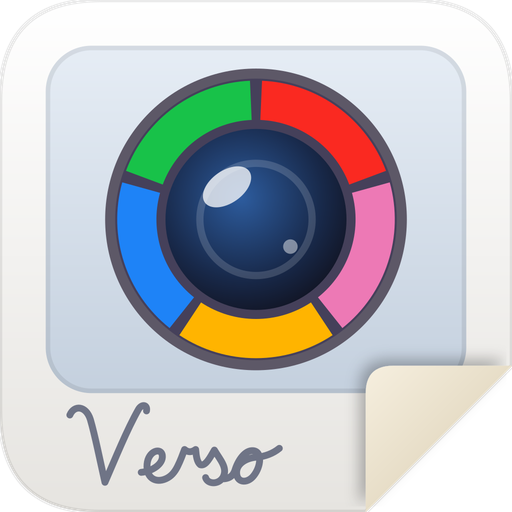
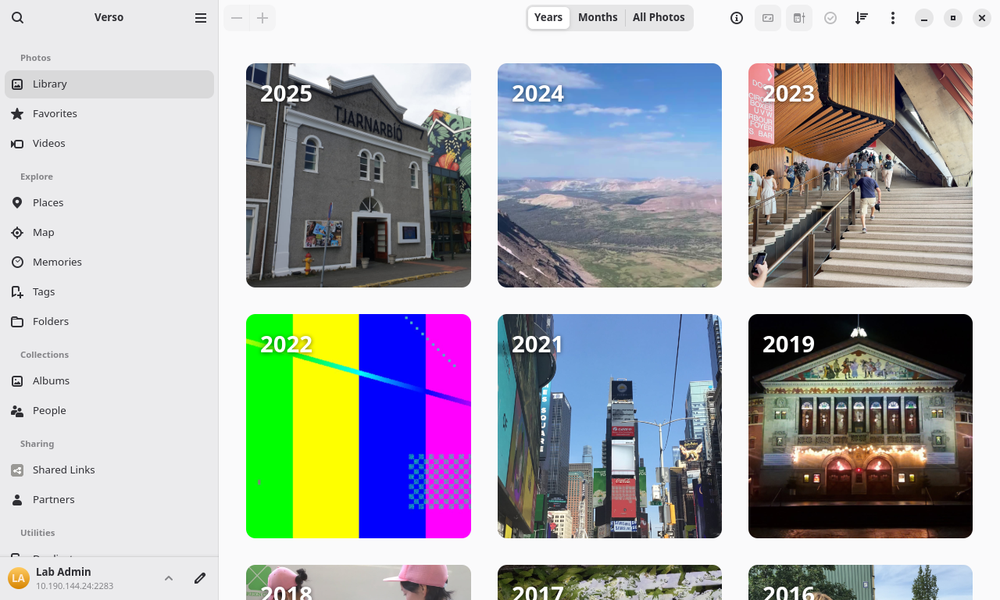
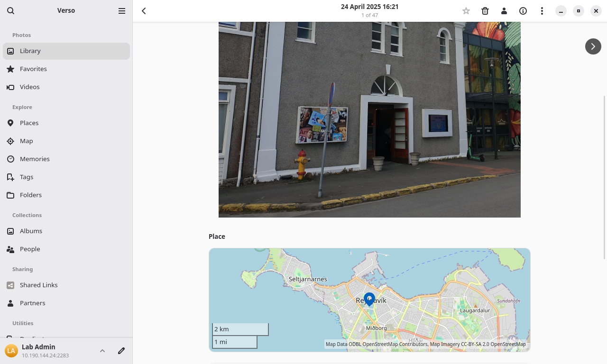
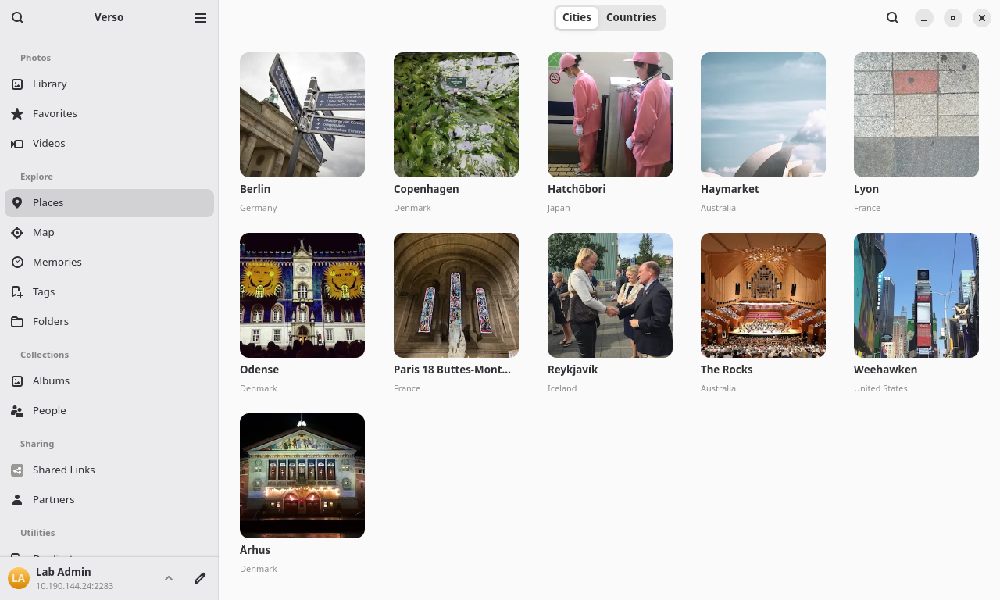
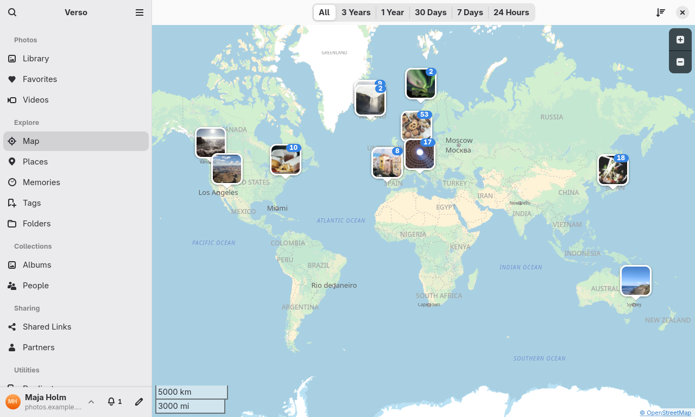
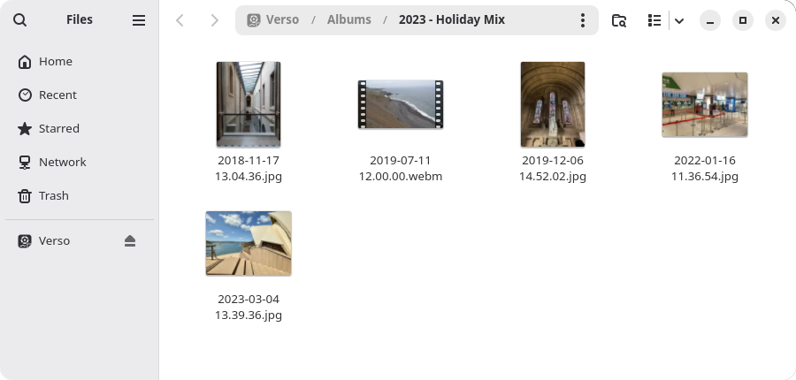

# Verso for Immich

**Your [Immich](https://immich.app) library in a native app on the iPhone, the iPad, the Mac and the Linux desktop:
browse, search, organise and share it, back your phone up to it, and, when you want it, keep the whole library as a
drive in Files or Finder.**

> Verso is an independent, unofficial project. It is not affiliated with, endorsed by, or sponsored by the Immich
> project or FUTO. "Immich" is used only to describe the server this software works with, and remains the mark of
> its owner.



Verso is one app, made natively for each platform it runs on: with SwiftUI and UIKit on the iPhone and the iPad, where
it looks and moves as Photos does; with SwiftUI and AppKit on the Mac; and with GTK 4 and libadwaita on Linux, made
for GNOME. Underneath, the platforms share one core in Rust: the Immich client, the drive's layout and the arithmetic
that places the grid's dates, so they behave alike.

| Platform | Where it stands |
|---|---|
| Linux, x86_64 (GNOME) | Released as 0.x builds: Homebrew, and a Flatpak test build (below) |
| Mac | Built here; no release yet |
| iPhone and iPad | Built here; no release yet. It will come through TestFlight and the App Store |

## What it does

- **Your whole library:** the timeline by year, by month or every photo, with a date scroller along its edge; albums,
  people, places and the map, memories, tags, folders, shared links, partners, duplicates, the archive, the trash and
  the Locked Folder.
- **A viewer that feels at home:** photos follow a swipe, the arrow keys or the touchpad; videos and Live Photos
  play; the photo's people, place, camera and file are a scroll down. On the iPhone and the iPad a photo opens out of
  its tile and pinches back into it, as in Photos.
- **Search** by what photos show, by text in them, by file name or description, narrowed by people, places, dates
  and cameras.
- **Organise and share:** favorites, albums, stacks, dates and locations, the archive, the trash and the Locked
  Folder; albums shared with people and by link; photos and folders imported from the device.
- **Verso Drive, when you want it:** your library as folders in Files on Linux, the iPhone and the iPad, and in Finder
  on the Mac, so any app can open a photo. Originals download only when something opens them. It is off until you switch it
  on.
- **Sign in your way:** with your server's single sign-on, with email and password, or with an API key. The sign-in
  stays in the system's keyring or Keychain.
- **Your account and server:** your profile, password, devices and API keys, and for an admin, the server's
  administration.

**On the iPhone and the iPad:**
- **Back up your photos** to Immich in the background, Live Photos, edits and favorites with them, and hidden photos
  into the Locked Folder.
- **Free Up Space** offers to remove photos from the phone once they are safely in Immich and old enough, never
  without asking, and keeps your favorites, the albums you choose and anything recent.
- **Verso in Messages:** pick a photo from your library straight into a message.

**On the Mac:** widgets with your photos, Shortcuts actions, and an icon in the menu bar.

**On Linux:** an icon in the top bar, which keeps Verso Drive working with the window closed, and Verso's menu in
Files.

**With other Immich apps, on the Mac and Linux:** Verso takes part in
[Immich Crosslink](https://jakob.hviid.phd/immich-crosslink/), so **Show in** opens the same photo, album, person or
place in another app that takes part, and those apps can show theirs in Verso. Where
[Immich Mount](https://jakob.hviid.phd/immich-mount/) is signed in on Linux, Verso offers to take its account over.

<table>
  <tr>
    <td></td>
    <td></td>
  </tr>
  <tr>
    <td></td>
    <td></td>
  </tr>
</table>

## Install on Linux

### Requirements

Verso is built for the current GNOME, so it needs **GNOME 49's libraries or newer** (libadwaita 1.8 and GTK 4.18), on
x86_64 Linux:

- **New enough:** Fedora 43 and newer, Ubuntu 25.10 and 26.04 LTS, Debian 14, Arch and other rolling distributions.
- **Too old:** Ubuntu 24.04 LTS and what is built on it (Linux Mint 22, Pop!_OS 24.04, Zorin OS 18), Debian 13,
  Fedora 42 and anything older. There Verso says so when it starts, and the [Flatpak](#as-a-flatpak-test-build),
  which brings GNOME's own libraries, runs instead, without Verso Drive.

Verso Drive needs FUSE 3, Verso's menu in Files needs nautilus-python, and the top bar icon needs a tray: on GNOME,
the AppIndicator extension.

### With Homebrew

```sh
brew install jakobhviid/tap/verso
```

Open **Verso** from the app grid and sign in. Update with `brew upgrade verso`; remove it with `brew uninstall verso`,
and add `--zap` to remove its settings and cache too.

### As a Flatpak (test build)

Download `verso-x86_64.flatpak` from the [latest release](../../releases/latest), then:

```sh
flatpak install --user verso-x86_64.flatpak
flatpak run dev.hviid.Verso
```

It fetches the GNOME runtime from Flathub. The Flatpak is Verso without the parts that need access outside its
sandbox:

- **No Verso Drive,** so no Show in Files and no Verso menu in Files. Preferences points to the Homebrew version,
  which has it.
- **Show in** is one **Show in Another App…**, where you choose the app, as a sandboxed app cannot list the others.
  Other apps still show their items in Verso.
- **No taking over Immich Mount's account:** you sign in as usual.
- **Starting at login** is asked by your desktop the first time you sign in.

## Building from source

**Linux,** on Fedora 44, or in a Fedora 44 toolbox (`toolbox create -r 44 verso`):

```sh
sudo dnf install gcc cargo rust gtk4-devel libadwaita-devel libshumate-devel blueprint-compiler fuse3
linux/packaging/verso-tarball.sh out
```

`out/verso` then holds Verso as the release tarball has it: `verso`, which opens the window (`libexec/verso`) once it
has checked the system's libraries, and `verso-service`, the top bar icon and the drive, with the icons and the
desktop entry. The two programs alone are `cargo build --release -p verso
-p verso-service`. [`linux/packaging/flatpak/dev.hviid.Verso.yml`](linux/packaging/flatpak/dev.hviid.Verso.yml)
builds the Flatpak, as its first lines say.

**The Mac, the iPhone and the iPad,** on a Mac with Xcode, Rust (through rustup) and XcodeGen: `mac/build-rust.sh`
builds the core for the Mac (with `--ios`, for the iPhone and the iPad too), and `xcodegen` makes the Xcode projects,
in `mac/Verso` and in `ios`.

[AGENTS.md](AGENTS.md), "Development environment" and "The green gate", has the rest: the checks every change passes,
signing a development build, and testing in virtual machines.

## How it is built

The repository is sorted by where the code runs:
- `shared/`: what every platform uses: the Immich API client, the portable core, and the bridge that Swift calls it
  through.
- `linux/`: the window, the service behind the top bar icon and the drive, the Files extension and the packaging.
- `mac/`: the Mac app, its widgets and Verso Drive's Finder extension, with the Swift that the iPhone shares.
- `ios/`: the iPhone and iPad app, its backup, and its extensions for Files and Messages.

Read on:
- [ARCHITECTURE.md](ARCHITECTURE.md): how the parts fit, and each design decision with its reason.
- [SPEC.md](SPEC.md): what Verso does, exactly, from the drive's folder names to its settings.
- [DESIGN.md](DESIGN.md): the icons, the colours, the words and each platform's interface.
- [ROADMAP.md](ROADMAP.md): what is not built yet.

## Status

Verso is young and changes quickly; its releases are numbered 0.x until the public launch. Problems and ideas are
welcome in this repository's [issues](../../issues).

## Credits

- Verso's Mac app is built from **[Immich Gallery](https://github.com/IGOLz/ImmichGallery)** for the Mac, by
  Alessandro Craciun, with contributions by Jakob Hviid, and its interface follows it on every platform.
- The drive, the service and the Immich API layer are **[Immich Mount](https://jakob.hviid.phd/immich-mount/)**'s,
  the same author's drive for Immich. Immich Mount is inspired by
  **[Immich Desktop](https://github.com/Kartax/immich-desktop-app)** by Kartax, a macOS app that shows an Immich
  library as a drive in Finder, and its API layer started from **[immich-rs](https://github.com/boul2gom/immich-rs)**
  (MIT).
- **[Immich](https://github.com/immich-app/immich)**, the server all of this talks to.
- The photos in the screenshots are the lab servers', Creative Commons and public domain photos from Wikimedia
  Commons, each credited in [lab/immich-server/fixtures/ATTRIBUTION.md](lab/immich-server/fixtures/ATTRIBUTION.md),
  and the map's in [lab/immich-server/fixtures/showcase/ATTRIBUTION.md](lab/immich-server/fixtures/showcase/ATTRIBUTION.md).
  Map data and imagery are OpenStreetMap's, as credited on the map.

More: [CREDITS.md](CREDITS.md).

## AI disclosure

Parts of this project were written with the assistance of AI coding agents. All changes are reviewed by the maintainer.
This is the single place that fact is disclosed; it is deliberately kept out of the commit history.

## License

[MIT](LICENSE). Code adapted from other MIT projects keeps its notice in
[THIRD-PARTY-NOTICES.md](THIRD-PARTY-NOTICES.md).

Take what you like. Immich's own apps, and anyone else, are welcome to copy any idea, design or code from Verso: the
cards, the pages, the backup, Verso Drive, whatever is useful.
